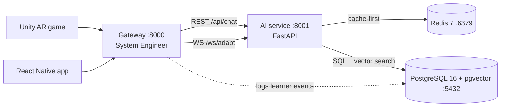
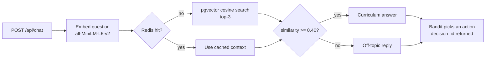

# EduAR-AI: AI Microservice

Grounded tutoring and real-time adaptation for an AR biology learning app (DNA and cell biology).

**Role:** AI Engineer (Shabab) | **Repo:** `StormyStack/Thesis` | **Branch:** `AI_Code_Works`  
**Stack:** Python 3.11, FastAPI, PostgreSQL 16 + pgvector, Redis 7, Docker  
**Status:** Thesis prototype. Retrieval works end to end; cache, ETL, and the WebSocket loop are not finished (see [Current status](#current-status)).  
**Last updated:** 9 October 2026

> Documentation history: [`final.md`](final.md) is the consolidated Week 4 report. It was written before the Week 5 work and contains targets and numbers that were never measured (for example a 45 ms retrieval time, a 450 MB image and "production ready"). **Where `final.md` and this README disagree, this README is correct.**

---

## Contents

1. [What this is](#what-this-is)
2. [Current status](#current-status)
3. [Architecture](#architecture)
4. [Repository layout](#repository-layout)
5. [Tech stack](#tech-stack)
6. [Quick start (Windows / PowerShell)](#quick-start-windows--powershell)
7. [Configuration](#configuration)
8. [API reference](#api-reference)
9. [How it works](#how-it-works)
10. [Database schema](#database-schema)
11. [Docker notes](#docker-notes)
12. [Verified results](#verified-results)
13. [Known issues](#known-issues)
14. [Troubleshooting](#troubleshooting)
15. [Roadmap](#roadmap)
16. [Git workflow](#git-workflow)
17. [Team and references](#team-and-references)

---

## What this is

EduAR-AI is an augmented-reality learning app. This repository holds the **AI microservice** (internal service on port 8001). It does two jobs:

1. **Tutoring with a guardrail.** A student question is embedded, matched against the curriculum stored in PostgreSQL with pgvector, and answered only from retrieved curriculum text. Questions that are not similar enough to the curriculum (cosine similarity below 0.40) are treated as off-topic.
2. **Real-time adaptation.** A contextual bandit chooses one of 8 pedagogical actions (show a hint, change difficulty, suggest a quiz, and so on) from an 8-dimensional learner state.

Redis is meant to sit in front of PostgreSQL as a cache (cache first, database on a miss).

The Gateway (port 8000), PostgreSQL/Redis setup and schema are owned by the System Engineer. The AR scenes (Unity) and the mobile app (React Native) are owned by two other team members. Clients reach this service through the Gateway.

## Current status

| Area | Status | Notes |
|---|---|---|
| Docker stack (PostgreSQL + pgvector, Redis, AI service) | Working | Single `docker-compose up -d` starts all three containers |
| Curriculum in pgvector | Working | 18 chunks, 384-dim embeddings, module `DNA_BIOLOGY_001` |
| RAG retrieval and guardrail | Working | Live test: 3 documents, similarity 0.567, on-topic |
| `GET /health`, `POST /api/chat` | Working | Verified live |
| Async database sessions | Working | `get_session()` is an async context manager |
| Redis cache layer | **Coded, not connecting** | Wrong URL passed to the cache client; fix in [Known issues](#known-issues) |
| WebSocket `/ws/adapt/{session_id}` | **Prototype, not tested** | Uses a random state vector; frame format differs from the spec |
| Contextual bandit | Epsilon-greedy baseline | Per-action mean reward; the state vector is validated but not fully used in the score |
| Scheduler / ETL | **Disabled** | Start calls are commented out in `main_service.py` |
| Event logging (A.3) | **Drafted, not run** | `events` table exists in SE's schema; `event_service.py` needs changes |
| Answer generation | Template only | `MOCK_LLM=True`: the reply is the retrieved text, no language model |
| Automated tests | Not run in Week 5 | `test_integration.py` exists from Week 4 |
| Latency / memory SLAs | Not measured | One live request measured: about 570 ms (cache miss) |

## Architecture



Chat request flow:



The AI service is internal. Authentication, rate limiting and HTTPS are expected to be handled by the Gateway.

## Repository layout

```
.
├── main_service.py            FastAPI app: endpoints, startup/shutdown
├── config_prod.py             Settings from environment variables
├── database_service.py        Async SQLAlchemy engine, pool, session manager
├── rag_service.py             Embedding, pgvector search, guardrail, cache-first retrieval
├── cache_service.py           Redis cache client with hit/miss stats
├── bandit_service.py          Epsilon-greedy contextual bandit (8 actions)
├── scheduler_service.py       APScheduler ETL job (currently disabled)
├── event_service.py           Event logging draft (not wired or tested; see Known issues)
├── load_curriculum.py         Chunk, embed and load the curriculum into pgvector
├── create_curriculum.py       Helper used to build the curriculum text
├── expanded_dna_curriculum.txt  Curriculum text that is loaded (8,740 characters)
├── dna_curriculum.txt         Original curriculum text
├── test_integration.py        Integration tests (Week 4; not re-run in Week 5)
├── client_examples.py         Example REST and WebSocket clients
├── Dockerfile                 Multi-stage image for the AI service
├── docker-compose.yml         PostgreSQL + Redis + AI service (all three containers)
├── 01_schema.sql              Database schema (owned by SE)
├── requirements.txt           Python dependencies
├── .env.example               Template for .env (placeholders only)
├── .dockerignore
└── final.md                   Week 4 consolidated report (historical)
```

`.env` is local only and must never be committed.

## Tech stack

| Technology | Role |
|---|---|
| Python 3.11 | Language and runtime |
| FastAPI, Uvicorn, Pydantic | REST and WebSocket server, request validation |
| sentence-transformers, `all-MiniLM-L6-v2` | Text embeddings, 384 dimensions, CPU only |
| PostgreSQL 16 + pgvector | Relational data and vector similarity search (cosine, IVFFlat index) |
| SQLAlchemy 2.0 (async) + asyncpg | Database access and connection pool |
| Redis 7 + redis-py (asyncio) | Cache and learner state |
| APScheduler | Periodic ETL job (designed; disabled) |
| NumPy | Vectors and bandit math |
| Docker, Docker Compose | Packaging and local deployment |

---

## Quick start (Windows / PowerShell)

**Prerequisites:** Docker Desktop (running), Python 3.11, Git.

### 1. Clone and configure

```powershell
git clone https://github.com/StormyStack/Thesis.git
cd Thesis\AI
git checkout AI_Code_Works

Copy-Item .env.example .env
notepad .env
```

Fill in **both** required secrets in `.env` (get passwords from SE):

```env
DB_PASSWORD=your_actual_password
REDIS_PASSWORD=your_actual_password
```

> **No manual URL-encoding needed.** `config_prod.py` automatically percent-encodes passwords when building connection strings. Just put the real password in `.env`.

### 2. Start all services

`docker-compose.yml` defines all three containers (PostgreSQL, Redis, AI service). Start them with one command:

```powershell
docker-compose up -d --build
```

- `--build` builds the AI service image (15–40 minutes the first time; omit on subsequent runs if code hasn't changed).
- On a fresh volume, PostgreSQL automatically runs `01_schema.sql`.
- The AI service waits for both PostgreSQL and Redis to be healthy before starting.

Check that all three containers are up:

```powershell
docker-compose ps
```

All three should show `Up` / `healthy`. Allow ~40 seconds for the embedding model to load inside the `eduarai_ai` container.

### 3. Load the curriculum

Run **once** from the host (not inside Docker) after the containers are healthy. This script connects to PostgreSQL via `localhost` by default.

```powershell
# Create and activate a virtual environment
python -m venv .venv
.\.venv\Scripts\Activate.ps1

# Install dependencies
pip install -r requirements.txt

# Load curriculum chunks + embeddings into pgvector
python load_curriculum.py
```

Verify the chunks were inserted:

```powershell
docker exec eduarai_postgres psql -U appuser -d eduarai -c "SELECT COUNT(*) FROM document_chunks WHERE module_id = 'DNA_BIOLOGY_001';"
```

Expected count: **18**. The script is safe to re-run for the module row (uses `ON CONFLICT DO NOTHING`), but it inserts chunks every time — clear them first if you reload:

```powershell
docker exec eduarai_postgres psql -U appuser -d eduarai -c "DELETE FROM document_chunks WHERE module_id = 'DNA_BIOLOGY_001';"
python load_curriculum.py
```

### 4. Verify the service

```powershell
# Health check
curl http://localhost:8001/health

# Chat endpoint (PowerShell requires escaping inner quotes)
curl -X POST http://localhost:8001/api/chat `
  -H "Content-Type: application/json" `
  -d '{\"question\":\"What is DNA?\"}'

# Cache statistics
curl http://localhost:8001/api/cache-stats

# Tail container logs
docker logs eduarai_ai --tail 50
```

Expected health response:

```json
{
  "status": "healthy",
  "database": "connected",
  "cache": "disconnected",
  "rag_ready": true
}
```

> `cache` shows `disconnected` until [Known issue #1](#known-issues) is fixed.

### 5. Stop

```powershell
docker-compose down
```

To also wipe the database volume (forces a fresh schema + curriculum reload next time):

```powershell
docker-compose down -v
```

---

## Running locally without Docker (development)

You can run the AI service directly on the host for faster iteration, but PostgreSQL and Redis must still be running in Docker.

```powershell
# Start only the backing services
docker-compose up -d postgres redis

# Activate the venv
.\.venv\Scripts\Activate.ps1

# Set DATABASE_HOST to localhost so the service reaches the published port
$env:DATABASE_HOST = "localhost"
$env:REDIS_HOST    = "localhost"

# Run the service
python main_service.py
```

The service binds to `http://127.0.0.1:8001` by default. Use the same `curl` commands from step 4.

---

## Configuration

All settings come from environment variables (`config_prod.py`). Secrets have no defaults and are **required** — the service will refuse to start if they are missing.

| Variable | Default | Purpose |
|---|---|---|
| `DATABASE_HOST` | `postgres` (compose service name) | PostgreSQL hostname. Use `localhost` when running on the host. |
| `DATABASE_PORT` | `5432` | PostgreSQL port |
| `POSTGRES_USER` / `POSTGRES_DB` | `appuser` / `eduarai` | Database login and name |
| `DB_PASSWORD` | **required** | Database password. Put the raw value in `.env`; the code URL-encodes it automatically. |
| `DB_POOL_SIZE` / `DB_MAX_OVERFLOW` / `DB_POOL_TIMEOUT` | `10` / `20` / `30` | Connection pool |
| `REDIS_HOST` | `redis` (compose service name) | Redis hostname. Use `localhost` when running on the host. |
| `REDIS_PORT` | `6379` | Redis port |
| `REDIS_PASSWORD` | **required** | Redis password. Put the raw value in `.env`; the code URL-encodes it automatically. |
| `EMBEDDING_MODEL` | `all-MiniLM-L6-v2` | Embedding model |
| `RAG_THRESHOLD` | `0.40` | Minimum cosine similarity to count as on-topic |
| `RAG_TOP_K` | `3` | Chunks returned per query |
| `RAG_TIMEOUT` | `5.0` | Query-encoding timeout in seconds |
| `BANDIT_EPSILON` | `0.15` | Exploration rate |
| `ETL_REFRESH_INTERVAL` / `ETL_SESSION_WINDOW` | `60` / `30` | ETL period (seconds) and active window (minutes) |
| `API_HOST` / `API_PORT` | `127.0.0.1` / `8001` | Bind settings used by the `python main_service.py` entry point |
| `MOCK_LLM` | `True` | Template answers instead of a language model |

### Inside Docker vs. on the host

| Where the code runs | `DATABASE_HOST` | `REDIS_HOST` |
|---|---|---|
| Inside the `eduarai_ai` container | `postgres` (set by compose) | `redis` (set by compose) |
| On the host (venv) | `localhost` | `localhost` |

The compose file already injects `DATABASE_HOST=postgres` and `REDIS_HOST=redis` via the `environment:` block, overriding the `.env` values for the container.

---

## API reference

Base URL: `http://localhost:8001`. In production, clients call the Gateway instead.

### `GET /`

Returns service info and a list of all endpoints.

### `GET /health`

```json
{
  "status": "healthy",
  "service": "eduarai-ai",
  "version": "1.0.0",
  "database": "connected",
  "cache": "disconnected",
  "rag_ready": true,
  "scheduler_running": false,
  "timestamp": "2026-10-09T03:00:00"
}
```

`status` reports that the process is up; check `database`, `cache` and `rag_ready` for the real state.

### `POST /api/chat`

Request:

| Field | Type | Required | Notes |
|---|---|---|---|
| `question` | string | yes | The student's question |
| `user_id` | string | no | Generated if absent |
| `session_id` | string | no | Generated if absent |
| `module_id` | string | no | Only used in the reply text today |

Response (measured, answer shortened):

```json
{
  "answer": "Based on the curriculum:\n\n[DNA_BIOLOGY_001] # DNA CURRICULUM ...",
  "is_on_topic": true,
  "max_similarity": 0.5666,
  "num_documents": 3,
  "latency_ms": 570.2,
  "decision_id": "42153e02-244a-44d0-b033-13dea1cda0df",
  "cached": false
}
```

Off-topic questions return `is_on_topic: false`, `num_documents: 0` and a polite refusal. Errors return HTTP 500 with `{"detail": {"error": "...", "latency_ms": ...}}`. A missing `question` returns HTTP 422 from Pydantic.

### `GET /api/cache-stats`

Returns `hits`, `misses`, `errors`, `total`, `hit_rate` and `redis_status`.

### `POST /api/cache-flush`

Clears the Redis database. For testing only.

### `WS /ws/adapt/{session_id}` (prototype)

Send `{"question": "..."}`. The server runs retrieval, asks the bandit for an action using a **random** state vector, and replies with:

```json
{"answer": "...", "is_on_topic": true, "action": 2, "latency_ms": 120.5, "cached": false, "timestamp": "..."}
```

This does not yet follow the specification's frame (action token, `scene_name`, `target_object_id`, hint payload), does not read the learner state from Redis, and does not update the bandit with a reward. It has not been tested end to end.

---

## How it works

### Retrieval and guardrail

1. The question is encoded to a 384-dimensional vector with `all-MiniLM-L6-v2`. Encoding runs in a worker thread under `asyncio.wait_for(RAG_TIMEOUT)` so the event loop is never blocked.
2. PostgreSQL ranks `document_chunks` by cosine distance and returns the top 3:

   ```sql
   SELECT chunk_id, module_id, content,
          1 - (embedding <=> '[0.01, -0.23, ...]'::vector) AS similarity
   FROM document_chunks
   ORDER BY similarity DESC LIMIT 3;
   ```

   `<=>` is pgvector's cosine distance, so `1 - distance` is the cosine similarity. The vector must be sent as a bracketed list string cast to `vector`. (An earlier version sent the raw bytes as hex, which made every query return zero documents.)
3. Chunks with similarity below `RAG_THRESHOLD` (0.40) are dropped. If none remain, the question is off-topic.
4. The remaining chunks are joined into a context string and returned as the answer (no language model yet).

The 0.40 threshold and top-3 come from the CTO specification. They have not yet been tuned on a labeled set.

### Curriculum loading

`load_curriculum.py` reads `expanded_dna_curriculum.txt` (8,740 characters), cuts it into fixed 500-character windows (18 chunks, no overlap), embeds them in one batch and inserts them. It first inserts the parent row into `modules`, which the foreign key requires (`ON CONFLICT DO NOTHING`). Limitations: windows cut mid-word, and the corpus contains a duplicated section.

### Cache design (Redis, cache first)

| Key pattern | Holds | TTL |
|---|---|---|
| `embedding:<text or md5>` | Query embedding | 1 hour |
| `docs:<module or all>:<hash>` | Retrieved documents | 1 hour |
| `context:<text or md5>` | Built context for a query | 30 minutes |
| `session:{id}:state` (spec) | 8-D learner vector written by the ETL | 3600 s |

If Redis is unreachable, every cache call returns nothing and the request falls through to PostgreSQL. This was observed in practice: chat kept working while the Redis connection was failing.

### Contextual bandit

`bandit_service.py` implements an **epsilon-greedy** policy over 8 actions: with probability 0.15 it explores a random action; otherwise it picks the action with the highest mean reward (unvisited actions are tried first; ties are broken randomly). Rewards are clipped to [0, 1]. The 8-D state is validated (length must be 8) but is **not used in the score**, so today this is a multi-armed bandit baseline with a contextual interface. Statistics are kept in memory per worker process and reset on restart.

Actions: `increase_difficulty`, `decrease_difficulty`, `maintain_difficulty`, `show_hint`, `hide_hint`, `suggest_quiz`, `suggest_ar_activity`, `switch_scene`.

### Scheduler / ETL (not active)

`scheduler_service.py` defines an APScheduler job (every 60 s) guarded by a Redis lock. It is disabled in `main_service.py`. It refreshes existing `session:*:state` keys in Redis but does **not** yet build the state vector from the `events` table as the specification requires.

### Event logging (A.3) and ETL (A.4): not done

SE's schema already contains an `events` table (see below). The first draft of `event_service.py` was written without checking that schema and **will fail as is**: `event_id` has no default, `scene_name` and `client_timestamp` are `NOT NULL`, `user_id` and `session_id` are UUID foreign keys, and the user and session rows must exist first.

---

## Database schema

Owned by SE (`01_schema.sql`). Summary of the tables this service uses:

| Table | Purpose | Key columns |
|---|---|---|
| `users` | Learner identity | `user_id` (UUID), `username`, `detail_level`, `language` |
| `sessions` | One learning session | `session_id`, `user_id` (FK), `started_at`, `ended_at` |
| `events` | Learner telemetry | `event_id`, `user_id` (FK), `session_id` (FK), `scene_name` (NOT NULL), `event_type`, `correct`, `time_spent_ms`, `payload` JSONB, client/server timestamps |
| `modules` | Curriculum modules | `module_id`, `name`, `scene_name`, `cdn_bundle_url` (NOT NULL), `difficulty` |
| `document_chunks` | RAG knowledge store | `chunk_id`, `module_id` (FK), `content`, `embedding vector(384)`, `created_at` |

`document_chunks` has an IVFFlat index (`vector_cosine_ops`, 100 lists). With 18 rows an exact scan is instant; the index matters only at larger scale.

---

## Docker notes

- **Containers:** `eduarai_postgres` (pgvector/pgvector:pg16), `eduarai_redis` (redis:7-alpine, password required), `eduarai_ai` (`eduarai-ai:latest`). All share the `eduarai_network` bridge network and are managed by `docker-compose.yml`.
- **AI service in compose:** the `ai-service` service in compose builds from the local `Dockerfile` and depends on `postgres` and `redis` being healthy before starting.
- **Image:** multi-stage build on `python:3.11-slim`; the builder installs all dependencies into `/install`, the final stage copies them plus all application files via `COPY . .`, and starts uvicorn on port 8001.
- **Build time:** a full `--no-cache` build takes roughly 15–40 minutes on a development laptop; sentence-transformers (which pulls PyTorch) dominates.
- **Image size:** ~9.7 GB on disk (3.3 GB content) because PyTorch is included.
- **Quick code update without rebuild:** for a single changed file use `docker cp` then restart:
  ```powershell
  docker cp main_service.py eduarai_ai:/app/
  docker restart eduarai_ai
  ```
- **Disk cleanup:** `docker builder prune` reclaims build cache.
- **Networking:** scripts run on Windows use `localhost` (ports are published by compose). `host.docker.internal` did not resolve from Windows Python.

---

## Verified results

Observed on the development machine (Windows 11, CPU only):

| Check | Result |
|---|---|
| PostgreSQL and Redis containers | Up and healthy |
| `SELECT COUNT(*) FROM document_chunks` (module `DNA_BIOLOGY_001`) | 18 |
| `GET /health` | HTTP 200, database connected, `rag_ready: true` (cache disconnected) |
| `POST /api/chat` with "What is DNA?" | `is_on_topic: true`, `max_similarity: 0.5666`, `num_documents: 3`, 570 ms, `cached: false` |
| Embedding model load at container start | about 25–35 seconds |

Not yet verified: off-topic rejection after the retrieval fix, a cache hit, WebSocket end to end, event insert and ETL, memory use, and the specification's accuracy targets.

---

## Known issues

| # | Issue | Fix |
|---|---|---|
| 1 | **Redis never connects.** `cache_service.py` ends with `CacheService(__name__)`, so the Redis URL is the string `"cache_service"`. Log: `Redis URL must specify one of the following schemes`. | `import config_prod as config` and `cache_service = CacheService(config.REDIS_URL)`. Keep `REDIS_HOST=eduarai_redis` in `.env` for host runs. |
| 2 | A cache hit returns the stored dict with `cached` saved as `False`. | In `build_context`, on a hit set `cached["cached"] = True` before returning. |
| 3 | The `docs` cache key uses Python's `hash()`, which differs between worker processes, so hits are lost. | Use `hashlib.sha1(query_embedding.tobytes()).hexdigest()`. |
| 4 | Startup logs "Redis cache connected" even when `connect()` failed. | Log based on `cache_service.client is not None`. |
| 5 | WebSocket handler uses a random state, does not update the bandit and does not match the spec's frame. | Rework after the ETL provides state in Redis. |
| 6 | Bandit ignores the state in its score; stats are per worker and in memory. | Linear contextual policy per the spec; persist weights. |
| 7 | Corpus has a duplicated section; fixed 500-character windows cut mid-word. | Deduplicate, split on sentences with overlap, reload. |
| 8 | Retrieval SQL is built with an f-string. | Use bound parameters. |
| 9 | CORS is open (`*`) and the service has no authentication. | Restrict origins; rely on the Gateway for auth. |
| 10 | `event_service.py` does not match SE's `events` schema. | See [Event logging](#event-logging-a3-and-etl-a4-not-done). |
| 11 | `.venv` was committed in an earlier push. | Ignore and untrack it (see [Git workflow](#git-workflow)). |
| 12 | `scheduler_service.py` ETL does not build state from events; it is disabled. | Implement per the spec, then re-enable. |

---

## Troubleshooting

| Symptom | Cause | Fix |
|---|---|---|
| `curl: Empty reply from server` | Container still loading the model, or workers crashed | Wait about 40 s; `docker logs eduarai_ai` |
| `ModuleNotFoundError` in logs | A Python import is missing | `pip install -r requirements.txt` inside the container, or rebuild with `docker-compose up -d --build` |
| `Connection refused` to Postgres/Redis | Backing containers not running | `docker-compose up -d postgres redis`; confirm with `docker-compose ps` |
| `num_documents: 0` with data present | Embedding passed to pgvector in the wrong format | Use the bracketed-list cast shown in [How it works](#retrieval-and-guardrail) |
| No documents at all | Volume was deleted; schema re-ran on an empty database | `python load_curriculum.py` |
| `Query encoding timeout` | `RAG_TIMEOUT` too tight | Default is already `5.0`; if still timing out, increase with `-e RAG_TIMEOUT=10.0` |
| `'coroutine' object does not support the asynchronous context manager protocol` | `get_session()` returned a coroutine | Use the `@asynccontextmanager` version in `database_service.py` |
| Password errors / `DB_PASSWORD` missing | `.env` not filled in, or file not found | Copy `.env.example` to `.env` and fill in `DB_PASSWORD` and `REDIS_PASSWORD` |
| `docker-compose up` fails with `Set DB_PASSWORD in .env` | `.env` missing required variable | Add `DB_PASSWORD=...` and `REDIS_PASSWORD=...` to `.env` |
| Docker commands fail | Docker Desktop not running | Start it, wait 60 s, run `docker ps` |
| Image pull fails (registry DNS error) | Docker Hub unreachable | Retry later; keep base images pulled before a demo |
| `pip install` fails with `UnicodeDecodeError` on Windows | Non-ASCII characters in `requirements.txt` | Keep the file ASCII only |

---

## Roadmap

Do these in order; each produces evidence you can show.

1. Fix the Redis connection and the cache flag/key (issues 1–4); confirm `/api/cache-stats` shows `redis_status: connected`.
2. Off-topic test: ask an unrelated question (for example the capital of France) and confirm `is_on_topic: false`.
3. Cache test: ask the same question twice; expect `cached: true` and lower latency on the second call. Record real latencies (median of 10 requests for miss and hit).
4. Measure memory with `docker stats --no-stream` (the specification budget is 1.8 GB).
5. Remove the duplicated chunk, reload the curriculum, and confirm the new chunk count.
6. Event logging and ETL: align with SE's `events` schema, seed a user, session and events, build the 8-D state from events into `session:{id}:state`, then enable the scheduler.
7. Rework the WebSocket handler to the spec's frame; read state from Redis; update the bandit with rewards.
8. Linear contextual bandit and a simulation against a random baseline (specification target: at least 30% higher cumulative reward).
9. Evaluation: 50 annotated questions for top-3 hit rate, 100 prompts (biology and adversarial) for guardrail precision, recall and F1; tune the threshold.
10. Language-model answer generation (Phi-3-Mini or Mistral-7B class) over the retrieved context; replace the template.
11. Re-run `test_integration.py`, add golden Q&A regression cases, and stress test at low concurrency.

---

## Git workflow

- Work on `AI_Code_Works`. SE's `data-layer` branch (compose file and schema) is locked: do not modify it.
- Never commit `.env`. Commit `.env.example` with placeholders only. Do not paste real passwords into any documentation.
- `.venv` and `__pycache__` must not be tracked:

  ```powershell
  Add-Content .gitignore ".venv/`nvenv/`n.env`n__pycache__/"
  git rm -r --cached .venv venv __pycache__ .env
  git status          # confirm only intended files are staged
  git commit -m "Remove virtual environment and secrets from tracking"
  git push origin AI_Code_Works
  ```

  (`git rm --cached` reports an error for any path that is not tracked; remove that path from the command and run it again.) Afterwards run `git ls-files | Select-String ".env"`. If `.env` was ever committed, treat its passwords as exposed and rotate them.

---

## Team and references

| Role | Owns |
|---|---|
| AI Engineer (Shabab) | This service: RAG, guardrail, bandit, cache layer, ETL design, curriculum ingestion, Docker image |
| System Engineer | `docker-compose.yml`, PostgreSQL and Redis, `01_schema.sql`, Gateway, event logging |
| Unity developer | AR scenes and execution of the 8 action tokens |
| React Native developer | Mobile app, chat UI, bridge to Unity |

References: the CTO specification for the AI Engineer role (RAG parameters, bandit actions, 8-D state, WebSocket protocol, test plan) and the thesis roadmap (A.1 model, A.2 dataset, A.3 data collection, A.4 ETL). Curriculum sources named in the corpus header: NCBI, OpenStax Biology, Khan Academy.
